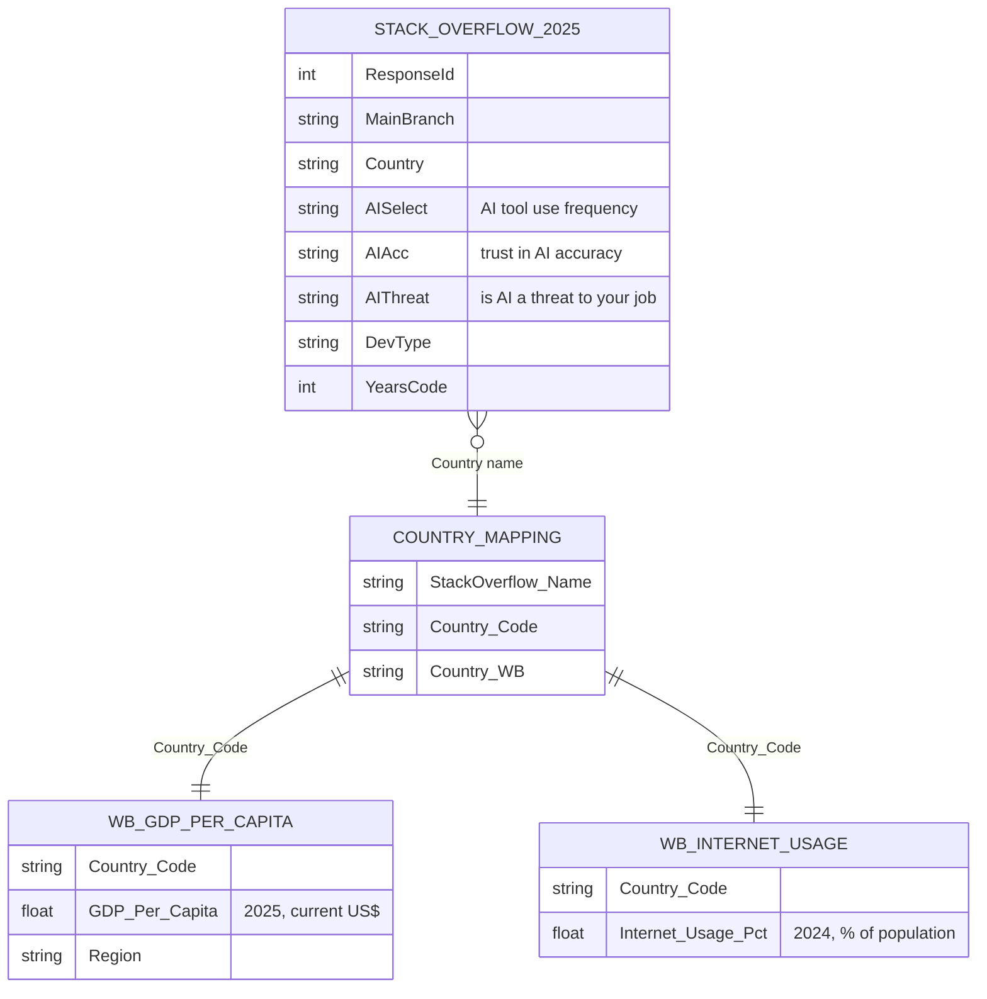
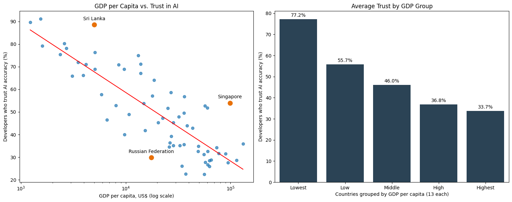
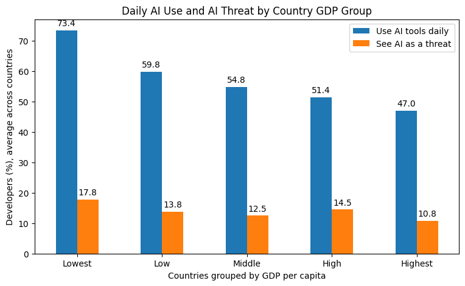
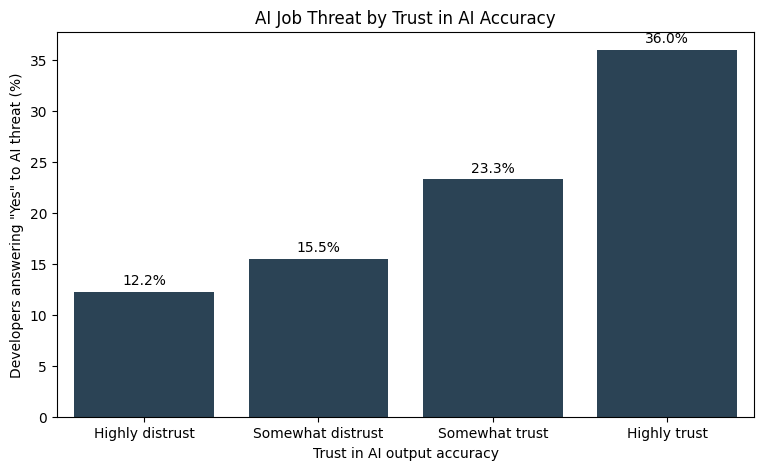
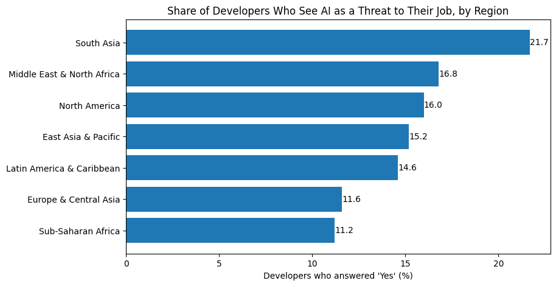
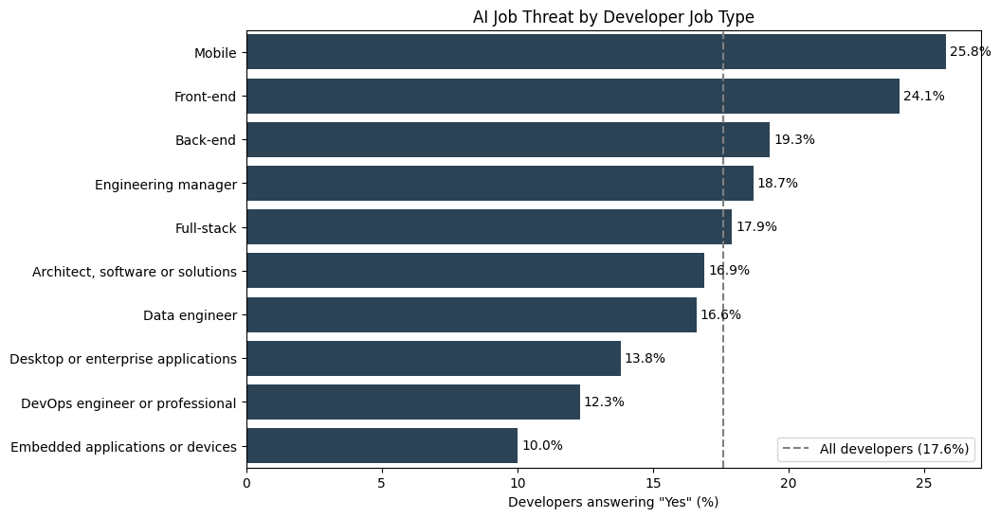

# Who Feels Threatened by AI? Developer Trust and Job-Threat Perception Across 65 Countries

Survey analytics in Python (pandas, seaborn), with a multi-source data merge, correlation analysis and LLM-based response scoring.

Team project for BA780 Introduction to Data Analytics, Boston University MSBA, Fall 2026.

## Background and overview

AI coding tools are now part of daily work for most professional developers. Employers deciding how to roll out these tools, and policymakers shaping AI, labor and education policy, need to know how developers feel about them and whether those feelings differ by country.

This project combines the 2025 Stack Overflow Developer Survey with World Bank country data to answer two questions:

1. Is a country's GDP per capita linked to how much its developers trust AI and see it as a threat to their job?
2. Is a country's internet usage rate linked to the same perceptions?

The full analysis, with code and every chart, is in the notebook: [B04-Project-Who-Feels-Threatened-by-AI.ipynb](B04-Project-Who-Feels-Threatened-by-AI.ipynb)

## Data structure

Three public sources, joined on the World Bank three-letter country code:

| Dataset | Raw size | After cleaning |
|---|---|---|
| [Stack Overflow Developer Survey 2025](https://github.com/StackExchange/Survey/tree/main/packages/archive) | 49,191 rows × 172 columns | 23,605 professional developers × 14 columns |
| [World Bank GDP per capita](https://data.worldbank.org/indicator/NY.GDP.PCAP.CD) | 265 rows (countries + aggregates) | 186 countries, 2025 values |
| [World Bank internet usage](https://data.worldbank.org/indicator/IT.NET.USER.ZS) | 265 rows | 182 countries, 2024 values (2025 is mostly missing) |
| Final merged table | | 22,753 developers in 65 countries (countries with 30+ respondents) |

To clean the survey, we kept only professional developers, dropped incomplete responses and removed impossible values such as 65+ years of coding. Stack Overflow and the World Bank spell 28 country names differently, so we built a mapping table to match them.

## Executive summary

Developers in poorer countries use AI tools the most and trust them the most. They are also the most worried that AI threatens their jobs.

- In the poorest fifth of countries, 77.2% of developers trust AI output, compared with 33.7% in the richest fifth (r = −0.83).
- 73.4% use AI tools daily in the poorest countries vs. 47.0% in the richest.
- 17.8% see AI as a threat to their job in the poorest countries vs. 10.8% in the richest.

Internet usage points the same way, but the link is weaker and mostly disappears when countries with similar GDP are compared. Where worry is highest, developers already use AI every day, so the open problem for employers and policymakers is job security.

## Insights

### 1. Trust in AI falls as country wealth rises

Trust drops at every GDP step: 77.2%, 55.7%, 46.0%, 36.8%, 33.7%. Nepal (91%), Nigeria (90%) and Sri Lanka (89%) have the highest trust. Russia trusts AI much less than its GDP would predict, while Singapore and Sri Lanka trust it more.

Developers in rich countries have more years of coding (median 18 vs. 9), but that does not explain the gap. Among developers with 20+ years of experience, 72.3% in the poorest group trust AI, compared with 31.2% in the richest.

### 2. The heaviest AI users are the most worried about their jobs

Daily AI use falls at every GDP step, from 73.4% to 47.0% (r = −0.81). The share who see AI as a job threat is highest in the poorest group (17.8%) and lowest in the richest (10.8%), though the decline is uneven (r = −0.40).

### 3. Developers who trust AI more fear for their jobs more

Developers who highly trust AI are three times as likely to see it as a threat (36.0%) as those who highly distrust it (12.2%), so trust in the tools alone does not make people feel secure.

### 4. South Asia and mobile and front-end developers feel most exposed

South Asia (21.7%, mostly India) has the highest threat share. Sub-Saharan Africa (11.2%) and Europe & Central Asia (11.6%) have the lowest.

Mobile (25.8%) and front-end (24.1%) developers are the most concerned, about 2.5 times the rate of embedded developers (10.0%). By age, concern peaks at 19.5% among developers aged 45 to 54.

### 5. Internet usage adds little once wealth is accounted for

Less connected countries show slightly higher threat (14.4% vs. 11.0%, r = −0.32). Within similar GDP groups, though, the correlations are weak and change sign. South Korea is the main outlier: it is highly connected and has a 30.4% threat share, from only 46 respondents.

### 6. A second measure gives the same results

We used the OpenAI API to score each respondent from 1 to 10 on AI trust and on job concern, based on five survey answers together. The scores show the same patterns. Concern averages 3.7/10 in the poorest countries and 3.1/10 in the richest, and 44.0% of developers in the least connected countries have high trust, compared with 26.3% in the most connected.

## Recommendations

1. Employers should pair AI tool rollouts with upskilling and clear career paths, starting with the groups that reported the most concern: mobile and front-end developers and mid-career staff aged 45 to 54.
2. AI companies should explain what their tools can and cannot do and how roles will change. Developers who trusted AI more were also more worried about their jobs.
3. Policymakers and educators should prioritize training and job-security support in lower-income markets such as South Asia. Internet access did not predict concern once GDP was controlled for, so programs should follow local labor-market needs.

## Caveats and assumptions

- All links are between country averages (65 data points) and show correlation only. Wealth and connectivity move together, so their effects cannot be fully separated.
- Stack Overflow respondents are not a random sample of developers, especially in countries with few responses. Countries with fewer than 30 respondents were excluded, which leaves 65 of about 195 countries.
- Some regions are mostly one country: South Asia is mostly India, and North America is about 85% US.
- GDP uses 2025 values; internet usage uses 2024 because 2025 is missing for most countries. Taiwan (80 respondents) has no World Bank data and was dropped.
- The national internet rate describes the whole population. Developers usually have good connections even where that rate is low.
- The LLM scores combine existing survey answers. They support the findings but cannot prove them on their own.

## Tools and skills

- Python: pandas (cleaning, joins, groupby aggregation, binning with `pd.cut`/`qcut`), NumPy, matplotlib, seaborn
- Analysis: Pearson correlation on log GDP, quintile grouping, outlier flagging against trend lines, controlling for experience
- Data engineering: Google Cloud Storage as the shared data source, custom country-name mapping table
- AI enrichment: OpenAI API with structured JSON output and parallel requests, plus a flag that loads cached scores instead of calling the API again, to control cost

The notebook reads data from the team's private Google Cloud bucket, so it will not run as-is outside the course. All three source datasets are public at the links above.

## Team

Team B04: Steven Nguyen, Ilya Barymov, YC Hsu, Muhammad Rafi.

I (Ilya Barymov) cleaned the Stack Overflow survey data with Muhammad Rafi, merged the three datasets into one analysis table, and assembled the team's parts into the final notebook. In the final presentation I covered the data overview, the internet usage findings and the conclusion.
