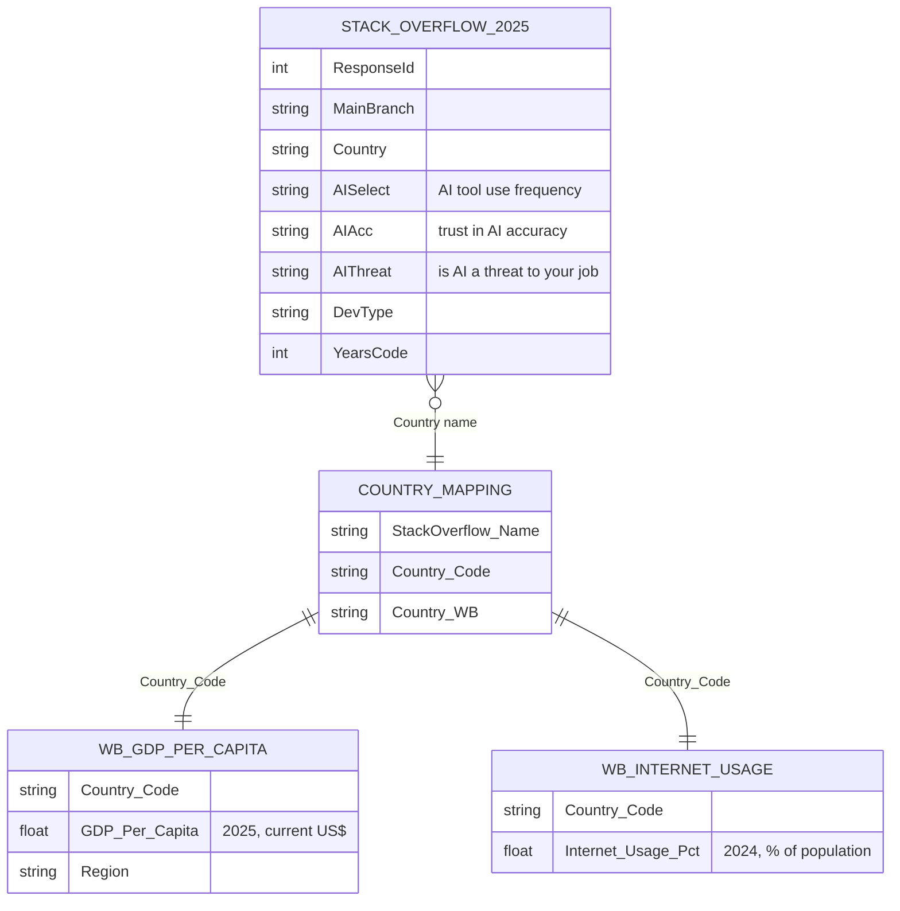

# Who Feels Threatened by AI? Developer Trust and Job-Threat Perception Across 65 Countries

**Survey analytics · Python (pandas, seaborn) · Multi-source data merge · Correlation analysis · LLM-based response scoring**

Team project for BA780 Introduction to Data Analytics, Boston University MSBA, Fall 2026.

---

## Background and Overview

AI coding tools are now part of daily work for most professional developers. Employers deciding how to roll out these tools, and policymakers shaping AI, labor and education policy, need to know how developers actually feel about them, and whether those feelings differ by country.

This project combines the 2025 Stack Overflow Developer Survey with World Bank country data to answer two questions:

1. Is a country's **GDP per capita** linked to how much its developers trust AI and see it as a threat to their job?
2. Is a country's **internet usage rate** linked to the same perceptions?

The full analysis, with code and every chart, is in the notebook: [B04-Project-Who-Feels-Threatened-by-AI.ipynb](B04-Project-Who-Feels-Threatened-by-AI.ipynb)

---

## Data Structure Overview

Three public sources, joined on the World Bank three-letter country code:

| Dataset | Raw size | After cleaning |
|---|---|---|
| [Stack Overflow Developer Survey 2025](https://github.com/StackExchange/Survey/tree/main/packages/archive) | 49,191 rows × 172 columns | 23,605 professional developers × 14 columns |
| [World Bank GDP per capita](https://data.worldbank.org/indicator/NY.GDP.PCAP.CD) | 265 rows (countries + aggregates) | 186 countries, 2025 values |
| [World Bank internet usage](https://data.worldbank.org/indicator/IT.NET.USER.ZS) | 265 rows | 182 countries, 2024 values (2025 is mostly missing) |
| **Final merged table** | | **22,753 developers in 65 countries** (countries with 30+ respondents) |

Key cleaning steps: kept only professional developers, dropped incomplete responses, removed impossible values (65+ years of coding), and built a mapping table to fix 28 country names that differ between Stack Overflow and the World Bank.

---

## Executive Summary

Developers in poorer countries use AI tools the most and trust them the most, and they are also the most worried that AI threatens their jobs.

- In the poorest fifth of countries, **77.2%** of developers trust AI output, compared with **33.7%** in the richest fifth (r = −0.83).
- **73.4%** use AI tools daily in the poorest countries vs. **47.0%** in the richest.
- **17.8%** see AI as a threat to their job in the poorest countries vs. **10.8%** in the richest.

Internet usage shows the same direction, but the link is weaker and mostly disappears once countries with similar GDP are compared. For employers and policymakers, the gap to close is not adoption: it is helping heavy AI users feel secure in their roles.

---

## Insights Deep Dive

### 1. Trust in AI falls as country wealth rises

Each step up in GDP group lowers the share of developers who trust AI output: 77.2% → 55.7% → 46.0% → 36.8% → 33.7%. Nepal (91%), Nigeria (90%) and Sri Lanka (89%) have the highest trust. Russia trusts AI much less than its GDP would predict, and Singapore and Sri Lanka trust it more.

The gap is not explained by experience. Developers in rich countries have more years of coding (median 18 vs. 9), but among developers with 20+ years of experience, 72.3% in the poorest group still trust AI compared with 31.2% in the richest.

### 2. The heaviest AI users are the most worried about their jobs

Daily AI use drops at every GDP step, from 73.4% to 47.0% (r = −0.81). The share who see AI as a job threat is highest in the poorest group (17.8%) and lowest in the richest (10.8%), though the decline is not smooth (r = −0.40).

### 3. More trust in AI means more fear for one's job

Developers who highly trust AI are three times as likely to see it as a threat (36.0%) as those who highly distrust it (12.2%). Building trust in AI tools does not, on its own, make developers feel secure.

### 4. South Asia and mobile/front-end developers feel most exposed

South Asia (21.7%, mostly India) has the highest threat share; Sub-Saharan Africa (11.2%) and Europe & Central Asia (11.6%) the lowest.

By role, mobile (25.8%) and front-end (24.1%) developers are the most concerned, about 2.5 times the rate of embedded developers (10.0%). By age, concern peaks at 19.5% among developers aged 45–54.

### 5. Internet usage adds little once wealth is accounted for

Less connected countries show slightly higher threat (14.4% vs. 11.0%, r = −0.32), but within similar GDP groups the correlations are weak and change sign. South Korea is the main outlier: highly connected, with a 30.4% threat share (from only 46 respondents).

### 6. Results confirmed with a second measure

We used the OpenAI API to score each respondent from 1 to 10 on AI trust and job concern, based on five survey answers together. These scores reproduce the same patterns: concern averages 3.7/10 in the poorest countries vs. 3.1/10 in the richest, and high trust is 44.0% in the least connected countries vs. 26.3% in the most connected.

---

## Recommendations

1. **Employers:** pair AI tool rollouts with upskilling and clear career paths, and focus first on the groups with the highest concern: mobile and front-end developers and mid-career (45–54) staff.
2. **AI companies:** be explicit about what tools can and cannot do and how they change roles. Higher trust in AI came with more job worry, not less.
3. **Policymakers and educators:** prioritize training and job-security support in lower-income markets such as South Asia, and design programs around local labor-market needs rather than internet access alone.

---

## Caveats and Assumptions

- **Correlation, not causation.** All links are between country averages (65 data points). Wealth and connectivity move together, so their effects cannot be fully separated.
- **Survey sample.** Stack Overflow respondents are not a random sample of developers, especially in countries with few responses. Countries with fewer than 30 respondents were excluded, which leaves 65 of about 195 countries.
- **Uneven regions.** South Asia is mostly India and North America is about 85% US, so those regional figures largely reflect one country.
- **Data years.** GDP uses 2025; internet usage uses 2024 because 2025 coverage is missing for most countries. Taiwan (80 respondents) has no World Bank data and was dropped.
- **National internet rate ≠ developer access.** Developers usually have good connections even where national rates are low.
- **LLM scores are derived, not new data.** They combine existing survey answers, so they support the findings but do not prove them on their own.

---

## Tools and Skills

- **Python:** pandas (cleaning, joins, groupby aggregation, binning with `pd.cut`/`qcut`), NumPy, matplotlib, seaborn
- **Analysis:** Pearson correlation on log GDP, quintile grouping, outlier flagging against trend lines, controlling for experience
- **Data engineering:** Google Cloud Storage as the shared data source, custom country-name mapping table
- **AI enrichment:** OpenAI API with structured JSON output, parallel requests, and a cost-control flag that loads cached scores instead of re-calling the API

> **Running the notebook:** the notebook reads data from the team's private Google Cloud bucket, so it will not run as-is outside the course. All three source datasets are public at the links above.

---

## Team

**Team B04:** Steven Nguyen, Ilya Barymov, YC Hsu, Muhammad Rafi

**My role (Ilya Barymov):** cleaned the Stack Overflow survey data (with Muhammad Rafi), merged the three datasets into one analysis table, and assembled the team's parts into the final notebook. In the final presentation I covered the data overview, internet usage findings and conclusion.
